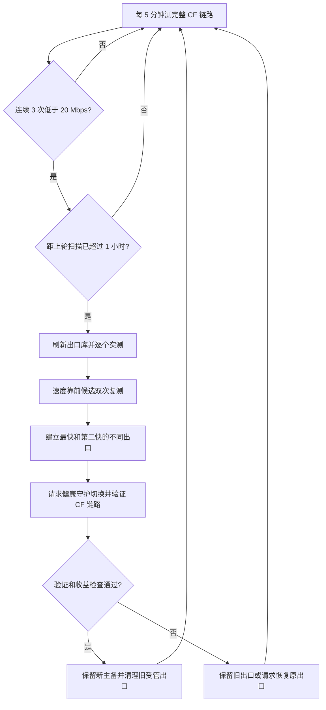

# vpn-socks

给 [byJoey/fanout](https://github.com/byJoey/fanout) 增加同地区出口热备、Cloudflare → VLESS 完整链路检测，以及低带宽触发的出口库自动优选。支持出口库实际提供的国家/地区，网页动态展示候选数量；每台服务器只从选定地区选择主备。适用于已经配置好 VLESS WebSocket、Cloudflare 端口回源的 Alpine/OpenRC 或 Debian/Ubuntu/systemd NAT 服务器。

## 默认策略

| 项目 | 默认值 |
|---|---|
| 低速阈值 | **20 Mbps**，约 2.5 MB/s，按完整 CF 链路计算 |
| 带宽抽测 | 每 5 分钟，最多下载 8 MB，最多等待 12 秒 |
| 触发条件 | 同一当前出口连续 3 次有效测速低于阈值 |
| 全库扫描冷却 | 扫描开始后至少间隔 1 小时 |
| 候选范围 | 最新 VPN Gate 列表中选定国家的全部节点（含志愿者和自营机房节点） |
| 扫描 | 独立网络命名空间逐个连接、核验出口 IP、下载测速 |
| 复测 | 首轮结果从快到慢，最多收集 6 个通过双次复测的候选 |
| 替换 | 按复测结果选择最快、第二快的不同出口作为主备 |
| 生效检查 | 主出口通过 CF 链路验证、备用再次连通，才清理旧的受管出口 |
| 最小收益 | 新 CF 路径相对触发时样本至少提升 20%，否则请求恢复原出口 |
| 断网恢复 | 独立健康守护继续工作；扫描期间保持旧出口和客户端参数 |

节点 UUID、WS 路径、客户端域名及 CF 回源规则不随出口替换而改变。切换会重启 fanout 管理的 Xray，现有连接可能中断。公共出口速度会变化，测速排名代表当次测量。

当前使用全部类型出口，不排除 `public-vpn-*` 或 `219.100.37.0/24`。国家限制、连通性验证、出口 IP 检查及速度排名保持生效。

## 安装前准备

- Alpine/OpenRC 或 Debian/Ubuntu/systemd、root，以及可用的 `/dev/net/tun`、network namespace、veth、iptables 转发。
- 按 [fanout 上游说明](https://github.com/byJoey/fanout#安装)安装 fanout，使用 **native Xray** 后端。Xray 路径为 `/var/lib/fanout/bin/xray`；管理端口从 `/var/lib/fanout/settings.json` 自动读取，建议仅本机监听。
- 在 fanout 中创建 `33002` 的 VLESS WS 入站，以及 `33003` 的 VLESS WS TLS 入站。两者使用同一个日本出口；另创建一条没有绑定入站的日本备用出口。
- 设置 CF 橙云域名、目的端口 **33003**，确保现有节点已经能经 CF 访问。源站若为自签证书，主机名使用 CF Full 模式；可信源站证书可以使用 Full (strict)。
- 默认使用上述节点端口；可通过安装参数指定单个 TLS 入站端口。入站 tag 和地区写入 `/etc/fanout-ha.json`。本机健康代理固定为 `127.0.0.1:10809` / `10810`。

```sh
git clone https://github.com/zhangx16/vpn-socks.git
cd vpn-socks
sh install.sh node.example.com
```

将 `node.example.com` 替换为已配置的 CF 节点域名。安装器从服务器现有的 fanout 私有配置读取 UUID、路径和证书，生成只监听本机的健康客户端，不要求将凭据写入项目。

只有一个可用公网端口的韩国部署示例：先在 fanout 创建 **35001** 的 VLESS WS TLS 入站，绑定韩国出口，再创建一条未绑定的韩国热备。CF 回源端口设为 35001，然后运行：

```sh
sh install.sh kr.example.com KR 35001
```

管理界面仍可使用任意空闲本机端口，例如 `127.0.0.1:33011`；通过 SSH 转发访问，无需占用公开端口。该模式只操作 `in-35001-ws`，全库扫描、故障恢复和热备均限定在韩国。

安装器首次采用选定国家的当前出口及一条未绑定的同国家备用出口作为受管主备。此后只清理该受管集合和优化器自己创建的临时出口，不删除其他已有入站绑定。受管槽位保存在 `/var/lib/fanout-speed/managed-slots.json`。

若 LXC 中 `ip netns exec` 报 `/sys` 挂载权限错误，而 `nsenter --net=...` 可用，可以启用已提供的兼容包装：

```sh
FANOUT_LXC_COMPAT=1 sh install.sh node.example.com
```

它只修改 fanout 服务的 PATH；启用时会重启 fanout，短暂中断现有连接。

在此兼容模式中，`nsenter` 会保留宿主的 DNS 配置。若 DNS 是 RFC1918 内网 IPv4 地址，包装器和扫描器会在各自命名空间内为该 DNS 添加经宿主网关的专用路由，避免 OpenVPN 默认路由把内网 DNS 请求送入 VPN。宿主 DNS 配置保持原样；这些 DNS 查询由宿主 DNS 处理，业务连接经过所选 VPN 出口。

## 工作流程



带宽守护和健康守护是两个进程。全库扫描可能持续数分钟，期间断网自动切换仍由健康守护负责。测速目标 HTTP 错误或不可达不计为低速；HTTP 200 下载因超时仅取得部分数据时，按已下载字节计算速度。更换当前出口会重置连续低速计数。

没有两条候选通过复测、连接失败、出口不符、CF 验证失败或收益不足时，不会清空原有主备。恢复原出口也依赖原出口当时可用；若它同时故障，由健康守护继续恢复。

## 修改阈值

配置文件：`/etc/fanout-speed.json`。每轮检查重新读取配置，无需重启：

```json
{
  "threshold_mbps": 20,
  "check_interval_seconds": 300,
  "consecutive_low": 3,
  "scan_cooldown_seconds": 3600,
  "sample_bytes": 8000000,
  "sample_timeout_seconds": 12,
  "finalists": 6,
  "minimum_gain_ratio": 1.2
}
```

Mbps 为十进制兆比特每秒，MB/s 为十进制兆字节每秒。抽测按默认值每天最多约 2.3 GB 下载流量；一次 35 节点扫描的理论下载上限约 236 MB（35×4 MB 首测，加 6×2×8 MB 复测），另有少量连通性和应用验证流量。扫描失败也受冷却限制。实际候选数量随公共出口库变化。

## 状态和维护

```sh
rc-service fanout-ha status
rc-service fanout-probe status
rc-service fanout-speed status
cat /var/lib/fanout-ha/status.json
cat /var/lib/fanout-speed/state.json
cat /var/lib/fanout-speed/selection.json
tail -n 50 /var/log/fanout-speed.log
```

`state.json` 包含最近 CF 测速、阈值、连续低速次数、扫描状态和最近错误。全库进度位于它的 `scan_directory` 对应的 `progress.log`。最多保留最近三轮扫描报告。

手动执行一轮采样或立即扫描时，先停带宽守护以释放锁。健康守护保持运行：

```sh
rc-service fanout-speed stop
fanout-speed --once       # 一次采样，达到条件时会扫描
# 或 fanout-speed --scan-now  # 跳过连续次数和冷却，立即验证一轮扫描
rc-service fanout-speed start
```

仅暂停带宽优化：`rc-service fanout-speed stop`。取消开机启动：`rc-update del fanout-speed default`。健康守护可继续工作。修改现有 VLESS UUID、域名或 WS 路径后，重新运行安装器生成健康配置。

服务日志按天、最大 1 MB 触发轮转，保留四份。报告、密码、证书、运行时状态都保存在服务器私有目录，禁止提交到 Git。

## 测试

```sh
python3 -m unittest discover -s tests -v
python3 -m py_compile bin/fanout-speed libexec/scan-jp scripts/configure-probes.py
bash -n bin/fanout-ha
sh -n install.sh
```

单元测试覆盖 20 Mbps 边界、连续计数、出口变更、测速错误、冷却和出口清理保护。真实扫描、主备切换及 CF 验证需要配置好上述环境；测试不会主动连接真实 VPN Gate 节点。

## 文件

- `bin/fanout-ha`：完整链路健康守护与串行切换请求处理。
- `bin/fanout-speed`：低速检测、扫描编排、主备替换和回滚请求。
- `libexec/scan-jp`：独立命名空间中的出口库测速。
- `scripts/configure-probes.py`：读取本机私有配置，生成 CF 和源站健康客户端。
- `openrc/`：三个进程的守护和开机自启服务。

依赖与许可见 [THIRD_PARTY.md](THIRD_PARTY.md)。

## 网页任务台

`web/control/` 提供仅本人可访问的 Sites 控制页：选择节点后，一键设置 Cloudflare 橙云 A 记录、Origin Rules 回源端口、主机名级 TLS Full/Strict，并通过 WebSocket 握手验收。支持只读检查、失败时恢复本次已完成的写入、逐步进度、导出结果和不含凭据的本机任务摘要。

CF Token 存在 Sites 的服务器运行时 Secret `CF_API_TOKEN` 中；节点预设使用 Secret `NODE_PRESETS`。源代码不包含实际 Token、服务器密码或节点私有配置。所需权限为 `Zone → Zone → Read`、`Zone → DNS → Edit`、`Zone → Origin Rules → Edit`、`Zone → Config Rules → Edit`，资源限定为目标 Zone。

该页面负责 CF 配置和链路验收；服务器上的出口健康检测与 20 Mbps 自动优选仍由上述 OpenRC 服务运行。WebSocket 握手成功不能独立证明最终 VPN 出口位置，完整代理出口仍应通过节点客户端检查。

构建前将 `web/control/.openai/hosting.example.json` 复制为 `.openai/hosting.json` 并填入当前 Sites 的项目 ID。保持 Site 为 owner-private，API 依赖 Sites 注入的已登录身份，不应直接部署为未经认证的公开 Worker。

```sh
cd web/control
node --test scripts/test.mjs
bash scripts/build.sh
node scripts/validate-artifact.mjs
```


## SSH 网页自动部署

控制页增加「SSH 自动部署」和「新增服务器」。选择实时出口地区，填写服务器 IPv4、SSH 端口、root 用户名及密码或私钥、节点域名、已映射的 TCP 回源端口和 WS 路径，然后提交任务。

后台执行以下步骤：检查并固定 SSH 主机密钥、检查系统和 TUN、上传当前部署脚本、安装 fanout/Xray、创建或复用相同配置的入站、连接所选国家出口、启用守护、配置 CF DNS/回源/TLS，并验证完整代理出口 IP 和国家。完成后返回可复制的 VLESS 链接。不会覆盖不同配置的已有端口，不会切换到别的国家凑数。

只有一条可用出口时允许部署，并显示无独立热备的提示。志愿者库的候选数不等于在线数；没有任何候选连通时任务会失败，不会伪造可用节点。

- SSH 密码、私钥和任务 CF Token 只保留在执行中的内存里，不写任务数据库或日志。
- 关闭网页不会终止任务；重新打开页面可以恢复该任务进度。
- 执行器重启会将未完成任务标为中断，因为凭据没有持久化；需重新填写凭据提交。
- 节点链接作为私有任务结果保存在执行器数据库，只有提交任务的账号可读取。
- 目标 NAT 的公开节点端口必须已映射到同名内部 TCP 端口；面板不会替你修改上游 NAT 映射。

现有真实 SSH 闭环已在 Alpine 服务器验证；Debian/Ubuntu 提供 systemd 安装路径，当前环境未做新实例实测。手动服务操作在 Debian/Ubuntu 上使用 `systemctl` 替代 `rc-service` / `rc-update`。

### 执行器

Sites Worker 不直接建立 SSH 连接，通过受认证的 HTTPS 执行器投递任务。执行器源码位于 `runner/`，当前安装器面向已有 fanout TLS 节点的 Alpine/OpenRC 主机。

- Sites Secret：`RUNNER_URL`、`RUNNER_TOKEN`，以及 `CONTROL_HOSTS`（禁止被节点配置覆盖的控制台域名 JSON 数组）。
- 执行器 `/etc/vpn-runner.json`：`auth_sha256`（随机 Token 的 SHA256）、`hostname`、`reserved_hosts`。只保存认证哈希，不保存明文执行器 Token。
- 执行器依赖：Python 3、Paramiko、Node.js、Nginx、iptables。
- 私有数据目录：`/var/lib/vpn-runner`，权限 0700；任务 SQLite 和 SSH known_hosts 仅 root 可读。
- API：受 Bearer 认证保护的 `GET /regions`、`POST /jobs`、`GET /jobs/{id}`；任务额外按服务端注入的账号标识隔离。

`runner/install.sh <执行器域名> <已有节点公开 TLS 端口>` 配置反代复用：公网节点端口通过一条专用 PREROUTING 规则转发至 Nginx 35012，按主机名分流节点和执行器；执行器仅监听 127.0.0.1:35013。既有节点转发回原来的 Xray 端口。该安装器的入站网卡默认为 eth0，部署至不同网卡的主机需调整。

执行器域名需单独配置 CF 橙云 A、回源到上述公开端口、主机名级 Full TLS；对这个经过密钥认证的 API 域名单独关闭 Browser Integrity Check，避免机器请求被浏览器检查阻断。控制台域名与其他节点的设置保持独立。

增加执行器测试：

```sh
# 已安装 Paramiko 后
python3 -m unittest discover -s tests -v
cd web/control
bash scripts/build.sh
node --test scripts/test.mjs scripts/test-bridge.mjs
```


### 手动刷新候选

出口地区列表由执行器缓存 10 分钟。页面在前台每 10 分钟自动读取，回到页面时也会读取。点击「获取最新候选」会通过受认证的 POST 接口跳过缓存，从上游重新获取并显示获取时间、地区数和候选总数。失败时保留原列表并提示失败，不会把旧缓存标成新结果。候选来自公开列表，真实连通性仍需部署或测速验证。


## 扩充上游出口池

单次 VPN Gate CSV 响应只包含部分公开节点。本项目使用官方主站 CSV，加上从官方镜像目录动态发现的镜像 CSV 进行汇总，不使用猜测的私有接口或扫描未知地址。每轮最多访问主站和 4 个镜像，镜像轮换选择，最多 3 路并发、每个请求限时 9 秒。后台每 10 分钟更新；网页手动获取可强制刷新。

汇总按独立公网 IPv4 去重。相同服务器域名出现新 IP 时淘汰旧配置；最近 24 小时未再次出现的节点自动过期。不同时间和不同来源的公开快照会积累到同一池中，因此数量可能逐步增长。历史候选不等于当前在线；连接验证和速度复测仍保留。

本机 `fanout-pool` 服务只监听 `127.0.0.1:35014`，提供 `/catalog.csv` 和 `/status`。数据库和 CSV 位于 `/var/lib/fanout-pool`。网页执行器、fanout 的原生管理器、新服务器部署，以及自动优选统一使用聚合结果。

fanout 上游没有可直接切换主 CSV URL 的参数，因此使用 `patches/fanout-catalog-source.patch` 的四行逻辑，新增 `FANOUT_VPNGATE_SOURCE` 环境变量。构建脚本固定上游版本 `d7ce5224caf3469b19876982abdf8d1be16c4a8b`，未设置环境变量时保持原来行为。`scripts/install-pool.sh` 安装聚合服务和配置，`scripts/build-fanout-pool.sh` 构建这个小补丁版本，需要 Go 1.24 或更新版本；若本机工具链太旧，构建脚本会从 Go 官方下载固定版本并校验官方 SHA256，再使用受限并行度编译。升级上游二进制会覆盖此改动，需重新应用补丁。

```sh
python3 /usr/local/libexec/fanout/catalog_pool.py --force
curl http://127.0.0.1:35014/status
```

官方镜像目录见 https://www.vpngate.net/en/sites.aspx 。目录内部分镜像只提供 HTTP，所以不将其当成 TLS 验证来源；导入时验证公网 IP、国家代码、Base64 和 OpenVPN 配置，并拒绝可执行脚本指令。不会承诺能获取官网统计中的全部中继，也不把全部中继总量当作候选数。


### 合并已管理服务器的官方快照

`/var/lib/fanout-pool/peers.json` 可配置最多两台已管理的采集服务器。使用专用 SSH 密钥，远端 `authorized_keys` 必须绑定固定的 `command="/bin/cat /var/lib/fanout-pool/pool.json",restrict`，并预先固定服务器主机密钥。采集器只接收该固定文件，不接受浏览器指定采集目标或远程命令。安装 SSH 客户端后，可在私有配置中提供 `name`、`host`、`port`、`user`、`key_file`、`known_hosts_file`。

合并时保留原快照的 `last_seen`，不会因为同步而延长失效节点寿命；对端失败不影响主站和官方镜像获取。SSH 私钥和实际 peer 配置不得提交到仓库。这样控制台可以同时利用不同已管理服务器从官方取得的不同公开快照。


### 部署前检查与错误诊断

安装软件包之前，会检查服务器已有 OpenVPN 命令是否包含明确的运营方禁用提示，以及 TUN 设备是否开放。遇到明确禁止 OpenVPN 的预置脚本，会提前终止并在任务页面显示具体原因，不解除文件保护、不替换禁用脚本。

若其他安装步骤失败，页面会显示步骤名、退出码和筛选后的错误摘要；密码、Token 及带密码的源地址会被脱敏。完整安装日志仍保存在目标服务器的私有任务目录。任务失败不再一律返回“服务器部署未完成”。
